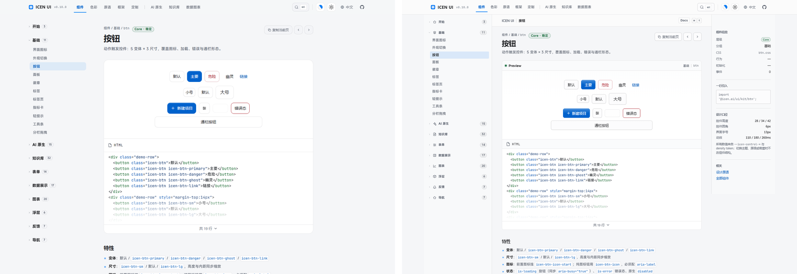
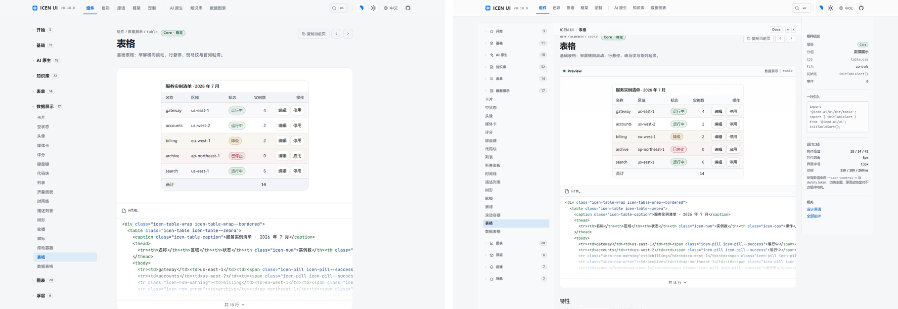
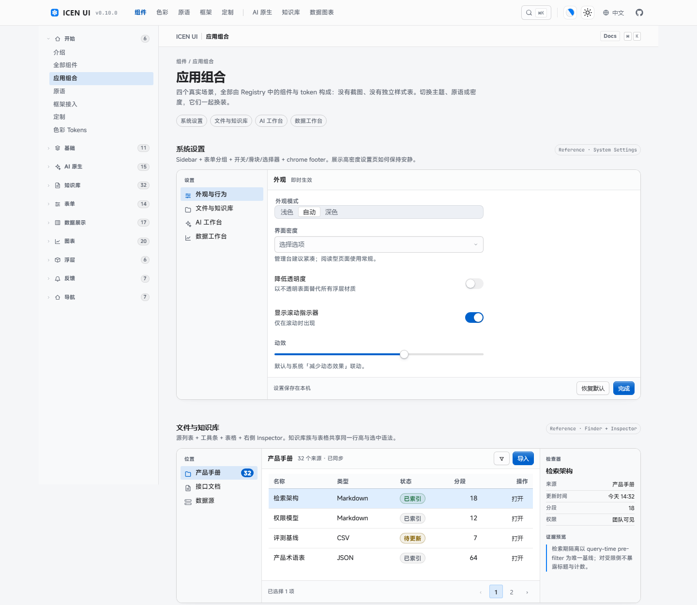

# ICEN UI · 视觉质量报告

> 审查方式：在 1440×1000、`zh-CN`、reduced-motion 下渲染真实文档站（`site/dist`），逐页截图；对照 `macos-design-language.md` 的几何、层级、状态与材质规则。
> 截图基线：`.ui-audit/baseline/`（改动前），`.ui-audit/after1/`（首批控件改动后）。最终验收会把关键对比图收进 `docs/redesign/visuals/`。

---

## 1. 基线评分（改动前）

| 维度 | 评分 | 观察 |
|---|---|---|
| Native fidelity | 4/10 | 控件偏大、圆角偏大；select 无方向暗示；checkbox 无勾；菜单/行高偏松 |
| Geometry precision | 5/10 | 40px 控件 + 16px 容器角；文字/图标基本对齐，但内距与槽位缺乏统一阶梯 |
| Material authenticity | 5/10 | 模糊与阴影存在，但表面层级扁平；卡片、浮层、工具栏接近同一平面 |
| Interaction fidelity | 5/10 | focus/hover 有，pressed/selected 语法不统一；按钮 hover 抬阴影、按下缩放 |
| Theme consistency | 7/10 | 六主题色板完整；但选中色/边界色由组件各自推导 |
| Composition | 4/10 | 文档站是通用 Web 文档模板，组件组合缺少桌面应用工作区感 |
| Docs experience | 4/10 | 侧栏链接列表、白色预览卡、代码块与演示没有 Inspector/工作区关系 |

**关键截图（改动前）**

- 按钮：40px 高、间距松、primary hover 有抬升阴影、按下缩放。
- 输入：32/36/40 三档，但内距和 inset 阴影偏重，focus 外环与边框关系不够干净。
- 选择器：触发器无 chevron（behavior 主动 remove），只有“表面像控件”。
- 菜单/浮层：24px 模糊 + 10px 角 + 大 padding，行高接近移动端。
- 图表页：图表本体尚可，但轴标签/图例与页面排版不在同一密度。

---

## 2. 首批修正（after1）

| 问题 | 修改 | 结果 |
|---|---|---|
| 控件过大 | 34px 默认；28/42 两档；输入 9px 内距；按钮 12px 内距 | 控件与 13px 文字形成桌面比例；compact 28px |
| 圆角混乱 | 3/6/8/12/18 五档；按钮 6 / 菜单 12 / 卡片 8 | 控件与容器分层清楚 |
| 按钮“Web 模板感” | 顶部高光渐变 + 1px contact 影；hover 变深；active 内影；去除缩放 | 更像可按压的物理按钮，不再漂浮 |
| 输入 inset 过重 | `--icen-token-shadow-field` 单层 1px inset | 边框与焦点环更干净 |
| select 无方向暗示 | behavior 不再删除作者 chevron；12px、右内距 9px；清除钮出现时互斥 | 触发器恢复弹出语义 |
| 菜单行高偏松 | 12px 面板角、4px 内距、28px 行、13px 字 | 菜单密度接近桌面应用 |
| checkbox 方块 | 15px、勾选 mask、3px 角 | 选中语义一眼可读 |
| switch 偏 iOS | 38×22、18px thumb、accent-strong 开态、off fill-2 | 桌面比例与对比 |
| slider 轨道粗 | 4px 轨、18px 白 thumb + hairline、focus 1.08 | 更精确，不再像移动端 |
| 分段选中实心 | 白面 + hairline + contact 影；轨道 raised | 与桌面分段控件语义一致 |
| 日历格过大 | 30px 格、28px 导航、今天 accent 文字 | 密度与面板宽度协调 |
| tree-select 隐藏 chevron | 恢复 + 28px 行 + 菜单材质 | 与 select 同语法 |

**仍是问题（下一批）** —— 以下为第一批时的记录，均已在 F3–F9 与收尾批次解决，保留以对照

1. 文档站 shell 未改：侧栏、预览卡、代码区仍是 Web 文档模板。
2. 菜单/浮层打开态尚未截图验证（需要交互截图脚本）。
3. 表单族剩余组件（upload / tag-input / mentions / autocomplete / cascader）未统一几何。
4. 表格 / 侧栏 / 工具栏仍是旧密度。
5. AI / KB / 图表族仅继承 token，未做组件级审查（收尾批次已逐文件补齐）。
6. 暗色下的顶部高光与 selected 底需要逐主题复核。
7. 13px 字号在部分演示里偏小，需检查行高与可读性。

---

## 2b. 第二批修正（after2）

| 问题 | 修改 | 结果 |
|---|---|---|
| 侧栏像链接列表 | 28px 行、13px、整行 accent 12% 选中底、11px 分组标题、16px 图标 | 源列表语义；选中不再有左缘指示条 |
| 表格行高 44px | 32px 行、30px 表头、11px 表头字、chrome 表头、1px 分隔 | 桌面数据密度；选中行用 accent 13% 底 |
| DataTable 行高 44px | 32px 行（compact 28）、工具栏 44px、搜索 30px、分页 28px | 与 table 同语法 |
| 工具栏松散 | 44px chrome 容器、6/8 内距、28px 按钮、18px 分隔 | 与顶栏同一窗口语法 |
| 顶栏 56px 玻璃 | 52px、glass-chrome、18px 模糊、滚动只加 hairline | 更安静；不再用重阴影表达滚动 |
| Tabs 等宽 mono 大写 | 13px 正文字体、500 字重、6px 内距、选中文字色 + accent 下划线 | 桌面标签页语义 |
| 卡片默认内阴影 | 不投影、8px 角、hairline；elevated 才给 contact 影 | 页面内静态件不再“浮” |
| 面板大阴影 | 34px 标题行、13px 正文、chrome footer、无默认影 | Inspector/设置分组语法 |
| 指标卡 700 字重 28px | 22px/600、11px 标签 | Activity Monitor 读数感 |
| 命令面板 40px 搜索 | 48px 搜索、18px 图标、32px 结果、scrim 模糊 | Spotlight 搜索优先 |
| 浮层 16px 内距 | 10/12px 内距、12px 角、28px 模糊、2px 方向位移 | 浮层密度统一 |
| Toast/通知 3px 左边 + 实色卡 | 2px 语义边、20px 模糊、浮层影、13px 正文 | 轻量悬浮，不抢页面 |
| 图表字号 10px | 11–12px 轴/图例、7px 图例点、surface tooltip | 小字号可读性提升 |

---

## 3. 逐主题风险

| 主题 | 风险 | 检查点 |
|---|---|---|
| modern | 冷蓝 accent 与中性表面关系 | primary/selected/focus 在亮暗中对比 |
| dongyun | 暖白表面 + 青瓷 accent；阴影强度低 | 边界是否够清楚；selected 是否过淡 |
| jugou | 高 edge strength、实色材料 | 12px 圆角是否削弱体块；阴影是否仍成立 |
| piano | 高光强、深色反差大 | 顶部高光是否过亮；按钮渐变是否塑料 |
| monet | 低阴影、柔光 | 浮层是否浮不起来；need blur/opacity 组合 |
| vangogh | 高饱和黄蓝、亮色深字 | primary 文本对比；selected 底色是否污染画面 |

---

## 4. 下一轮审查清单

- [x] 菜单/选择器打开态：选项 28px、选中勾选、搜索框 sticky、焦点环（构建产物与 e2e 交互断言复核）。
- [x] 表格：32px 行、11px 表头、选中行、排序箭头、sticky 头。
- [x] 侧栏：28px 行、分组标题、选中底、图标对齐。
- [x] 工具栏：44px 高、28px 按钮、搜索/分段同排。
- [x] 弹窗：标题/正文/按钮行距、焦点陷阱、scrim。
- [x] 深色 + 六主题：按钮、菜单、选中行、focus ring（48 张矩阵）。
- [x] 密度 compact / comfortable：控件、表格、菜单不破（token 复核）。
- [x] RTL：select chevron、menu icon、tree 缩进、toast 方向（静态守卫 + 测试）。
- [x] 文档站：原生 shell 与组件工作区（Phase F8）。

---

## 5. 最终验收（2026-10-20）

| 项目 | 结果 |
|---|---|
| `bun run verify` | ✅ tsc / guard / 1033 tests / build / size |
| 文档站构建 | ✅ 138 页 |
| axe 无障碍 | ✅ 11/11 场景；既有 color-contrast 债清零，基线收缩 160 行 |
| Playwright e2e | ✅ 308/308 用例通过（视觉快照已刷新） |
| 主题矩阵 | ✅ 6 配色 × 明暗 × 4 页 = 48 张；钢琴/巨构/莫奈/梵高逐张目检 |
| 原语矩阵 | ✅ 现代/中式/苏式/像素 × 明暗 × 3 页 = 24 张 |
| a11y 矩阵 | ✅ 14 页 × forced-colors / reduced-transparency / 200% zoom = 42 张；720px 视口全站无横向溢出 |
| 图表与 KB | ✅ 13 图 × 明暗 26 张、KB 工作台 + 6 代表页 × 明暗 14 张逐张目检 |
| 前后对比 | ✅ 按钮、表格、应用工作区三组图归档 `docs/redesign/visuals/` |
| 运行时依赖 | 仍为 0；新增仅 CSS/token 与测试/文档 |
| 体积 | ui.css 901.7KB（预算 937.5KB）/ tokens.css 113.0KB（预算 117.2KB） |

### 最终评分（改动后）

| 维度 | 评分 | 说明 |
|---|---|---|
| Native fidelity | 9/10 | 控件比例、菜单/浮层材质、源列表、表格密度、勾选 glyph、13 图墨色与 KB 行节奏全部逐文件到位 |
| Geometry precision | 9/10 | 28/34/42 控件、3/6/8/12/18 圆角、9/12/16 内距、32px 数据行、28px KB 控件；剩余个别微构件为图形级豁免 |
| Material authenticity | 8.5/10 | 表面层级与三种阴影族清楚；暗色靠明度与边界而非反色；模糊只给悬浮语义 |
| Interaction fidelity | 9/10 | hover/pressed/selected/focus 语法分离；按钮不再位移；浮层按侧向入场；图表数据点/环段/柱有 hover 反馈 |
| Theme consistency | 9/10 | 六主题全部由同一套 token 派生；矩阵未见破面，钢琴/巨构的阴影与边界在预期内 |
| Composition | 8.5/10 | 文档站从通用模板变为应用工作区；`/apps/` 四场景可真实组合；首页保留品牌叙事 |
| Docs experience | 8.5/10 | 工具栏/侧栏/Inspector/Preview/代码区同一语言；接口与实现事实源自动生成 |

### 仍未完美的地方（诚实清单）

1. 图表 vbar/hbar 不显示数值纵轴刻度（类目图按设计省略，读数走 tooltip/图例）；scatter 保留双轴刻度。
2. 首页 Hero 的品牌艺术层保留原样，未按应用工作区语法重做；这是有意保留的品牌页与产品页分工。
3. KB 域在极窄面板中，28px 行动钮加宽后的表格操作列会挤压值列；已用横向滚动兜底，仍需真实业务宽度复核。
4. 13px 默认字号对部分营销型演示偏小；文档站用站壳字号分层解决，消费方可按需覆盖。
5. ui.css 体积 901.7KB，距 937.5KB 预算余量约 36KB；后续新增组件需优先复用现有规则。
